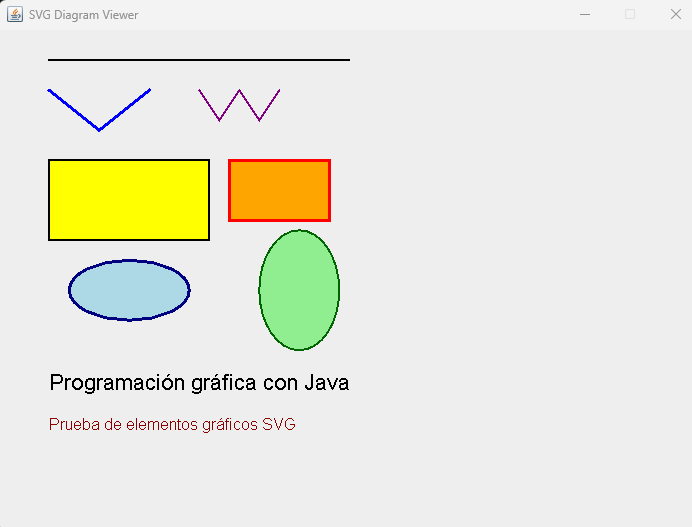
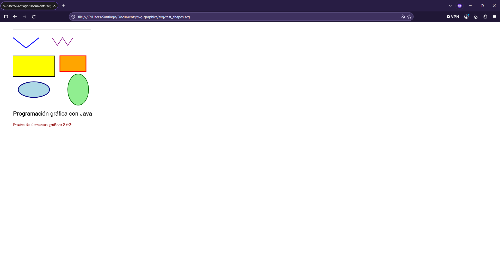

# Reporte Tecnico

Se conservo la arquitectura basada en eventos SAX y Java 2D para mantener un diseño limpio y eficiente. Durante el desarrollo, la mayor dificultad fue parsear correctamente las coordenadas de las polilineas (polyline) y asegurar la captura adecuada del texto dentro de las etiquetas correspondientes. Para validar la integracion, se realizaron pruebas funcionales con el archivo svg/test_shapes.svg, en la ventana de Swing y con el navegador web. La limitacion que yo veo es que no puede generar formas geometricas avanzadas.

# Evidencias

Aqui se encuentran las capturas de las pruebas realizadas:

## Ventana swing



## Navegador



# Diagrama

```text
[ DisplayDiagram ] ──> [ SVGDiagram ] ──> [ TagsHandler ]
(Punto de entrada)      (Renderizado)        (Procesa SAX)
```

# Preguntas de reflexion

1. ¿Qué ventajas ofrece utilizar SAX para procesar documentos SVG? Es muy ligero y rapido porque lee el archivo linea por linea en lugar de cargarlo todo entero en la memoria.
2. ¿Qué diferencias existen entre interpretar la información geométrica de un elemento y representarlo gráficamente? Interpretar es leer los datos del XML (como coordenadas y tamanos) para guardarlos en codigo, mientras que representarlo es usar esos datos para dibujar la figura en la pantalla.
3. ¿Cómo contribuye el polimorfismo a simplificar la representación de distintos elementos gráficos? Permite guardar todas las figuras en una sola lista y dibujarlas con una misma instruccion, sin importar si son rectongulos, texto o lineas.
4. ¿Por qué es importante conservar el orden de los elementos dentro de un documento SVG? Porque define que figura se dibuja encima de cual, si se cambia el orden, las formas se taparian de manera incorrecta.
5. ¿Qué modificaciones serían necesarias para incorporar nuevos elementos como circle, polygon o path? Solo habria que agregar el cadigo para reconocer la nueva etiqueta en TagsHandler, guardar sus datos y definir como dibujarla